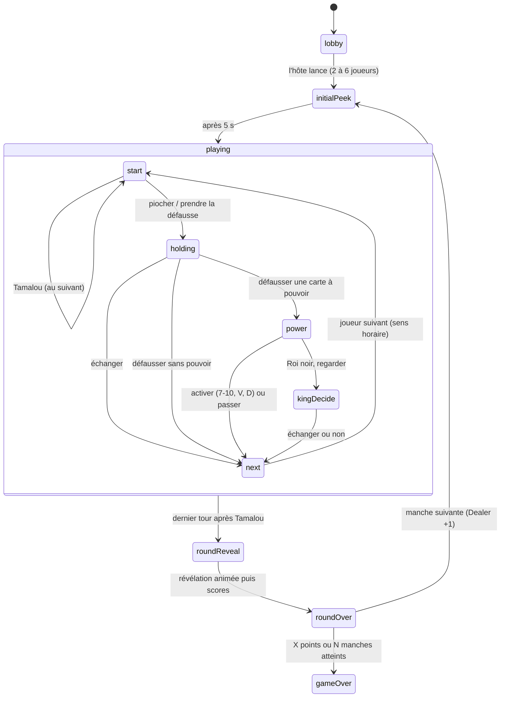
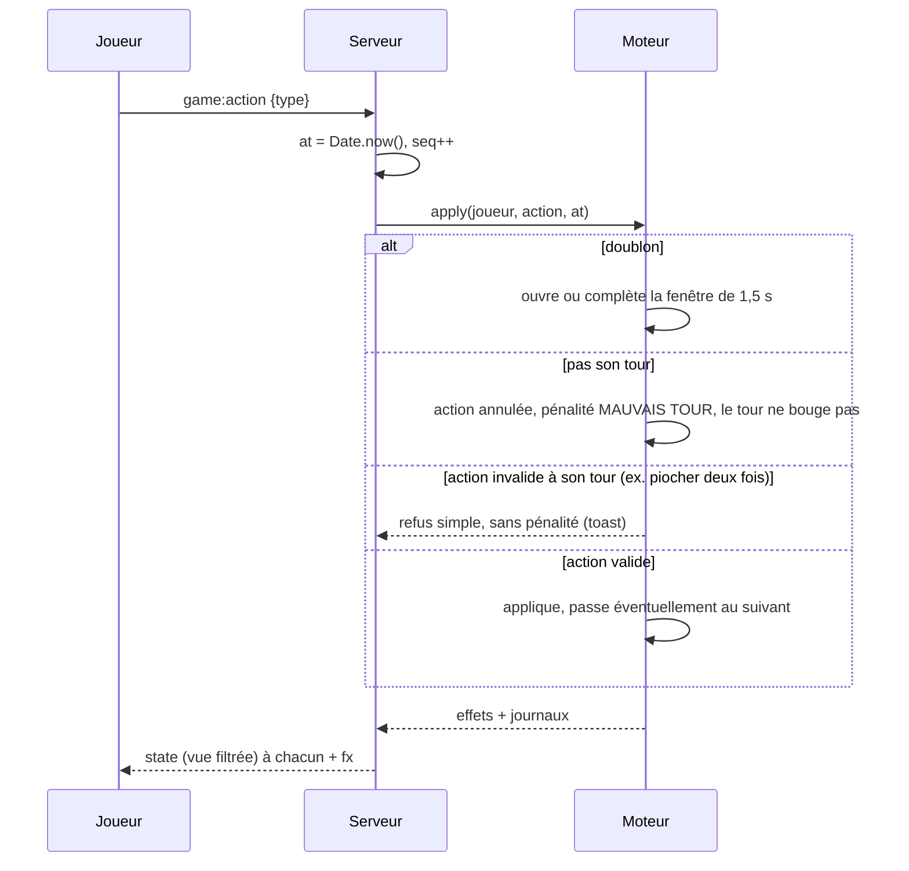

# Tamalou : architecture et modèle d'état

Étape 1 sur 9. Ce document fixe la structure du code, le modèle d'état et les
règles arbitrées avant d'écrire le moteur.

## 1. Vue d'ensemble

```
tamalou/
├── shared/   types communs : cartes, actions, vues filtrées, protocole Socket.IO
├── server/   Node + Express + Socket.IO
│   └── src/
│       ├── engine/   moteur de règles PUR (aucun réseau, aucun timer, aucune horloge)
│       ├── bots/     IA : ne reçoivent que leur vue filtrée + leurs effets
│       ├── rooms/    salons en mémoire (Map), jetons de reconnexion, remplaçants
│       └── index.ts  Express (sert aussi le build client) + Socket.IO
├── client/   React + Vite + Tailwind, PWA, cartes et singes en SVG
│   └── public/sounds/  monkey-laugh.mp3, jungle-yell.mp3, fail-jingle.mp3…
└── Dockerfile  un seul service (Render ou Fly.io)
```

```mermaid
flowchart LR
  subgraph Téléphones
    A[Client React] -- "game:action" --> S
    B[Client React] -- "game:action" --> S
  end
  S[Socket.IO\nhorodatage serveur] --> R[Room\nMap en mémoire]
  R --> E[Moteur pur\napply(action, now)]
  E --> R
  R -- "vue filtrée par joueur\n(state)" --> A
  R -- "effets (fx)" --> B
  R --> BOT[Bots\nvue filtrée uniquement]
  BOT -- "game:action" --> R
```

## 2. Principes

1. **Serveur autoritaire.** Tout l'état vit dans le serveur. Chaque client reçoit
   une `ClientView` construite pour lui seul.
2. **Aucune fuite.** Les cartes en grille ne portent aucun identifiant côté client :
   seulement « place occupée ou vide ». Une valeur n'est envoyée que pendant une
   révélation autorisée (vue initiale, 7/8, 9/10, Roi noir, faux doublon, fin de manche),
   avec son heure de fin. Une fois la révélation terminée, la valeur disparaît de la vue.
3. **Le serveur juge la vitesse.** Chaque action reçoit `at = Date.now()` et un numéro
   d'ordre `seq` à la réception. C'est ce couple qui départage les doublons.
4. **Moteur pur.** `engine.apply(playerId, action, now)` et `engine.tick(now)`
   modifient l'état et renvoient les effets à diffuser. Le hasard est injecté
   (`random`), ce qui rend tests et simulations reproductibles. La salle (room) pose
   un seul `setTimeout` sur la prochaine échéance (`engine.nextDeadline()`).
5. **Les bots jouent à la loyale.** Ils passent par la même file d'actions que les
   humains et ne lisent que `ClientView` + `GameFx`. Leur mémoire est construite
   à partir de ce qu'ils ont vu.

## 3. Modèle d'état

### Côté serveur (`server/src/engine/state.ts`)

| Élément | Contenu |
| --- | --- |
| `EngineState` | options, joueurs (ordre des sièges, sens horaire), index du Dealer, manche en cours, manches jouées |
| `EnginePlayer` | id, pseudo, avatar, bot ou non (+ niveau), `slots: (Card \| null)[]`, score cumulé |
| `RoundState` | pioche, défausse, joueur dont c'est **réellement** le tour, étape du tour, Tamalou, fenêtre de doublon, révélations en cours |
| `TurnStep` | `start` → `holding` (carte en main) → `power` → `kingDecide` (Roi noir) |
| `DuplicateWindow` | carte visée, ouverture, fermeture (+1,5 s), tentatives `{joueur, place, at, seq}` |
| `Reveal` | quelle carte, pour qui (`all` ou liste), jusqu'à quand, pourquoi |

### Grille de cartes

Positions fixes, 2 par rangée. Les pénalités s'empilent **au-dessus** :

```
  [6] [7]   ← 2e rangée de pénalité
  [4] [5]   ← 1re rangée de pénalité
  [0] [1]   ← départ, rangée haute
  [2] [3]   ← départ, rangée basse (vue 5 s au début)
```

Une pénalité prend la première place libre d'index ≥ 4, sinon ouvre une rangée.
Une place vidée par un doublon reste vide : rien ne se décale, la mémoire des joueurs reste valable.

### Côté client (`shared/src/game.ts`)

`ClientView` : phase, joueurs (avec `slots: SlotView[]` sans valeur), Dealer,
joueur actif (**`null` sauf option de l'hôte**), nombre de cartes de la pioche,
dessus de défausse, carte en main (valeur visible par son détenteur seulement),
pouvoir en cours, indicateur « Tentative en cours… », Tamalou, résultat de la
dernière manche, journal personnalisé, heure serveur.

`GameFx` : effets ponctuels qui déclenchent pop-ups, sons et animations
(pénalité, doublon réussi, pioche, défausse, échange, regard, Tamalou, fin de manche).

## 4. Machine à états



## 5. Traitement d'une action



## 6. Règles arbitrées

Là où le cahier des charges laisse une marge, voici ce que j'ai retenu. Dis-moi
si tu veux en changer un avant l'étape 2.

| # | Situation | Choix |
| --- | --- | --- |
| 1 | Prendre la défausse | Deux temps comme à la table : `takeDiscard` (carte en main, visible de tous) puis `swapHeld`. Une carte prise à la défausse ne peut pas être redéfaussée telle quelle. |
| 2 | Qu'est-ce qui déclenche MAUVAIS TOUR ? | Toute action de tour (piocher, prendre la défausse, échanger, défausser, pouvoir, Tamalou) envoyée par un autre joueur que celui dont c'est le tour. Les doublons ne sont jamais concernés. |
| 3 | Action invalide pendant son propre tour (piocher deux fois…) | Refus simple avec un message, sans pénalité. |
| 4 | Défausse pendant une fenêtre de doublon | Pendant les 1,5 s, les actions qui changent le dessus de la défausse (défausser, échanger, prendre la défausse) sont mises en attente avec le message « Attends la fin de la tentative… ». Piocher reste possible. Sans ça, la carte visée changerait en cours de fenêtre. |
| 5 | Doublon réussi | La carte rejoint la défausse et devient le nouveau dessus : un autre joueur peut enchaîner un doublon sur elle. Sa place reste vide. |
| 6 | Doublon pendant la vue initiale de 5 s | Refusé sans pénalité (la partie n'a pas commencé). |
| 7 | Faux doublon de la carte qu'on tient en main | Impossible : le doublon vise toujours une carte de sa grille. |
| 8 | L'annonceur Tamalou | Ne joue plus et ne peut plus faire de doublon. Ses cartes ne peuvent plus être échangées (Valet, Dame, Roi noir) ; elles peuvent encore être regardées (9, 10, Roi noir sans échange). |
| 9 | Plus aucune carte | Au début de son tour, le serveur annonce Tamalou automatiquement pour lui. |
| 10 | Pénalité quand la pioche est vide | On remélange la défausse sauf sa carte du dessus. S'il n'y a vraiment plus rien, pas de carte de pénalité (cas extrême). |
| 11 | Faux doublon révélé | Visible par tous 2 s, puis remis à la même place, face cachée. |
| 12 | Pénalités multiples | Plusieurs fautifs dans la même fenêtre : une carte chacun, une seule pop-up qui les liste. |
| 13 | Égalités en fin de manche | Annonceur à égalité avec quelqu'un = annonceur perdant. Égalité entre non-annonceurs pour le plus petit score : ils gagnent ensemble. |
| 14 | Fin de partie en multi-manches | Mode points : la partie s'arrête à la fin de la manche où quelqu'un atteint X ; vainqueur = plus petit total. Mode N manches : plus petit total après N manches. Égalité : vainqueurs ex æquo. |
| 15 | Vue initiale de 5 s | Chacun voit ses cartes 2 et 3 (rangée du bas). Les bots les mémorisent selon leur niveau. |
| 16 | Remplaçant après 60 s de déconnexion | Le bot Moyen ne connaît que ce que le joueur a vu pendant la manche **depuis sa prise de relais** (il ne lit pas la mémoire du joueur, il n'en a pas). À son retour, le joueur reprend la main immédiatement. |

## 7. Plan des étapes

1. ✅ Architecture + modèle d'état (ce document, `shared/`, `server/src/engine/state.ts`)
2. Moteur + tests Vitest (pouvoirs, hors tour, fenêtre 1,5 s, pénalités, fin de manche, égalités, pioche vide)
3. Serveur Socket.IO (salons, codes à 4 lettres, reconnexion, horodatage)
4. Bots IA (mémoire par niveau, décisions, doublons, simulation de 200 parties)
5. Client + thème graphique jungle (cartes SVG, singes, dos de carte, jeton Dealer)
6. Sons et pop-ups
7. Tchat
8. PWA
9. Déploiement (Dockerfile + README pas à pas)
